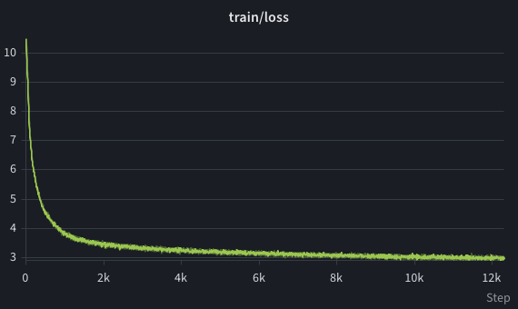
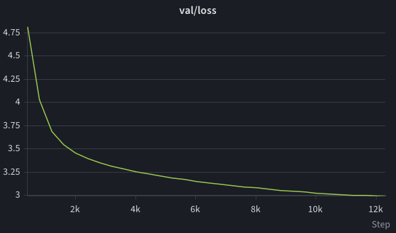
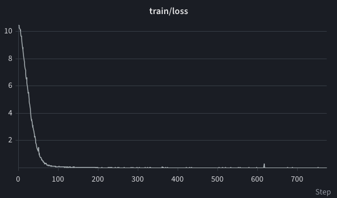
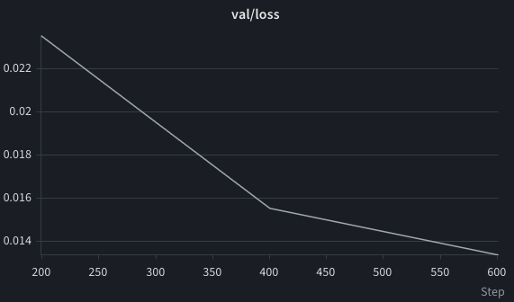

# Llama Style 50M Language Model

A lightweight, modern 50M parameter causal language model built completely from scratch using PyTorch, optimized with the `uv` package manager, and equipped with Distributed Data Parallel (DDP) training and Weights & Biases tracking.

[HugginFace](https://huggingface.co/asoloveii/llama-style-50m)

---

## Overview

This project implements a state-of-the-art transformer architecture from scratch, adhering to modern Llama design principles. It provides efficient data preprocessing pipelines, optimized GQA KV-caching for inference, and distributed multi-GPU training script.

## Installation & Setup

This project uses the fast **`uv`** package manager for dependency management. Clone the repository and sync dependencies before running scripts:

```bash
git clone https://github.com/asoloveii/llama_style_50m.git
cd llama_style_50m

# install dependencies and set up the virtual environment
uv sync
```
## Model Architecture

The model incorporates modern architectural improvements over standard transformers:
* **RoPE (Rotary Position Embeddings):** Encodes relative spatial/temporal positions effectively across sequences.
* **GQA (Grouped-Query Attention):** Shares key-value heads across multiple query heads to reduce memory bandwidth overhead.
* **SwiGLU:** Replaces traditional ReLU/GELU activations in the feed-forward networks for superior language modeling capabilities.
* **KV Caching:** Pre-allocated buffer-based key-value caching enables fast, efficient token-by-token text generation.

## Data Loading & Preparation

The pipeline supports high-throughput downloading and sharding for massive pretraining datasets like Hugging Face FineWeb, alongside instruction-tuning data like Alpaca.

### Running Data Scripts
Prepare your datasets before training using `uv`:

```bash
# download and shard HF FineWeb dataset
uv run python scripts/load_fineweb.py --total_tokens 1_700_000_000 \
                                      --shard_size 100_000_000 \
                                      --output_dir "./datasets/fineweb" \
                                      --num_workers 4 

# download Alpaca instruction dataset
uv run python scripts/load_alpaca.py --ouput_dir "./datasets/alpaca"
```

## Training with Distributed Data Parallel (DDP)

Training scales across multi-GPU setups using PyTorch's native DDP alongside real-time experiment tracking with `wandb`.

To launch distributed training across available GPUs (e.g., 4 GPUs):
```bash
uv run torchrun --nproc_per_node=4 train.py
```

## Training loss history

### Pretraining phase



### SFT instruction tuning phase




## Project Structure
```
llama_style_50m/
├── train.py
├── utils.py
├── scripts/
│   ├── load_fineweb.py
│   └── load_alpaca.py
├── src/
│   ├── model/
│   └── data/
└── pyproject.toml
```